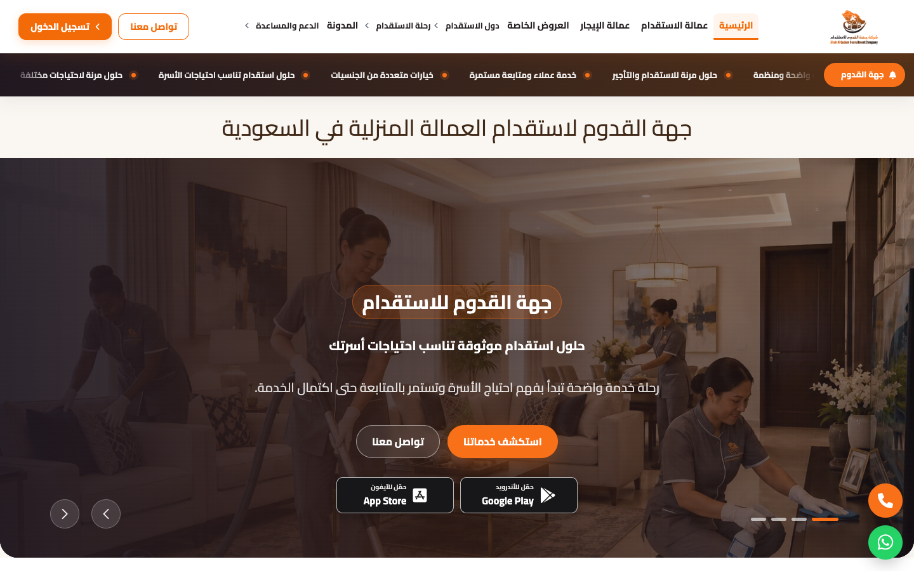
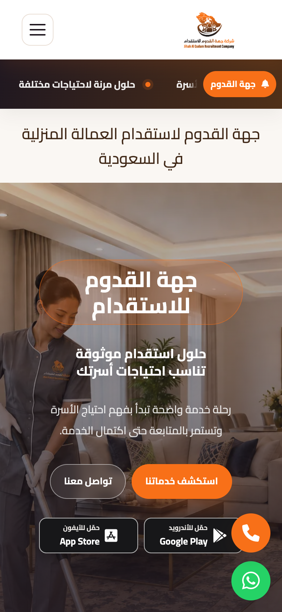
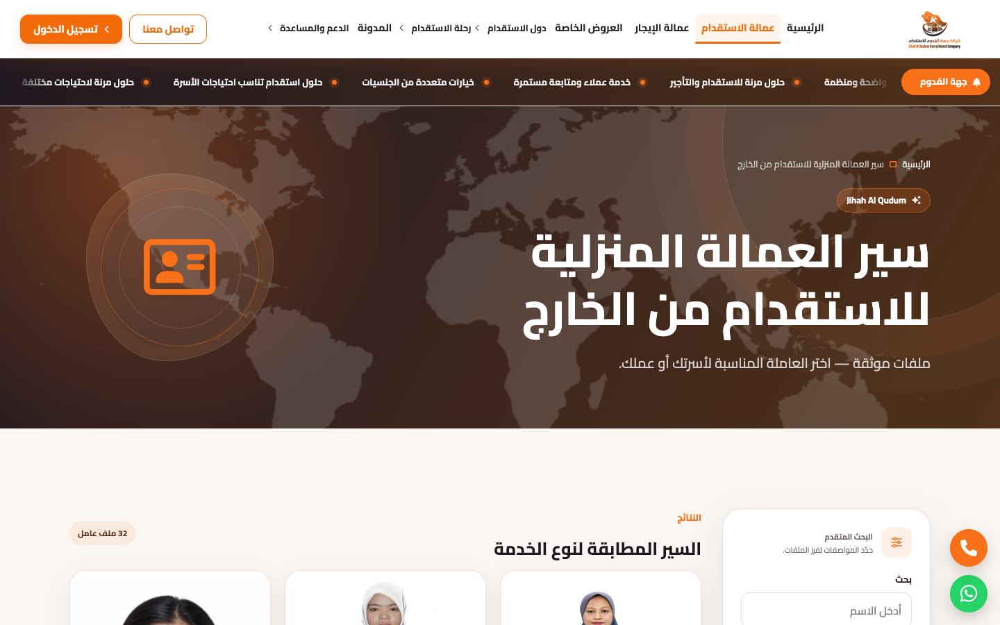
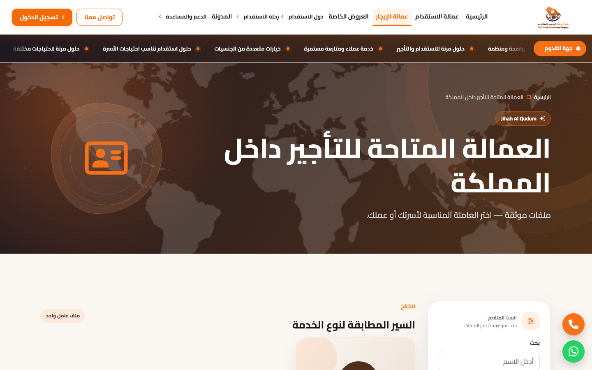
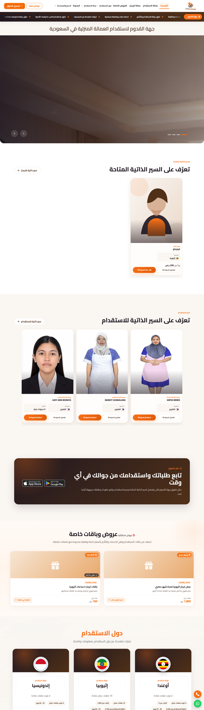
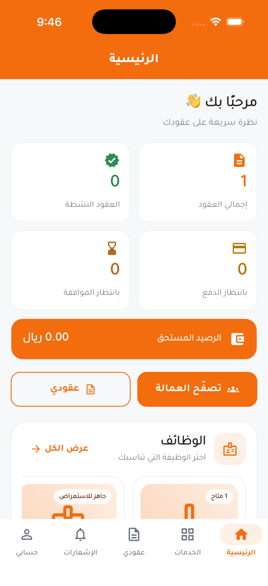
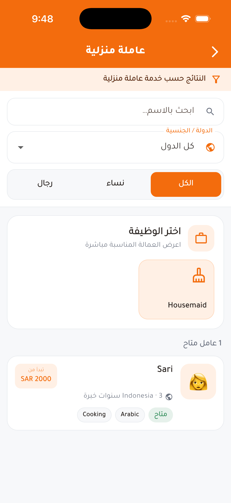
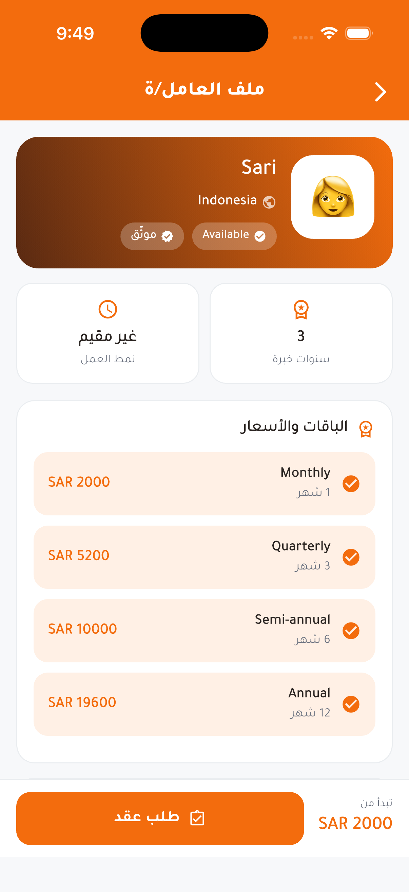
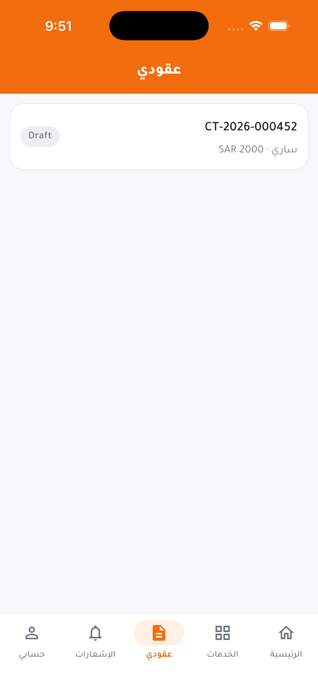
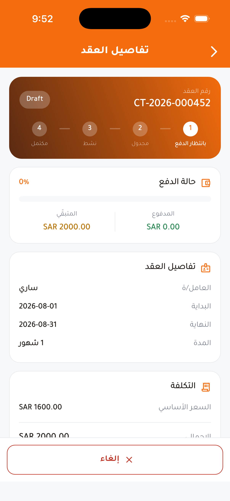

# Jihah Al Qudum (جهة القدوم)

> Saudi recruitment and domestic-worker rental platform.

**Live:** [jihahalqudum-co.com](https://jihahalqudum-co.com/) · **Role:** Technical lead & developer · **Period:** 2026 · **For:** Al Shohab Al Aliyah

      

## Overview

A platform for direct recruitment through Musaned and for monthly, yearly and hourly worker rental: clients browse workers, request them, sign contracts, pay in installments and follow everything online or from the mobile app.

## What it does

- Worker catalog by nationality, skills and experience
- Recruitment requests and rental contracts
- Installment plans and online payment
- Renewals, cancellations, refunds and worker replacement
- Contract PDF based on the Musaned unified contract
- Admin back office with branches, reports and WhatsApp booking

## Engineering highlights

- Contract state machine (13 states) with an immutable audit trail
- No double booking: date-range reservations under database row locks, proven by a concurrency test
- Signature-verified, idempotent payment webhooks
- Rule-based pricing snapshotted onto each contract
- ~300 commits, pull-request workflow, CI/CD to Hostinger

## Screenshots (live site)

  
  
  

Full home page

## Mobile app (Flutter)

| Home | Catalog | Worker | Contracts | Contract |
|---|---|---|---|---|
|  |  |  |  |  |

---

Source code is private (client / commercial project). This repository documents the work only.

Built by **Ahmed Gamal** — Senior Laravel Developer · [LinkedIn](https://www.linkedin.com/in/wzcoder/) · [GitHub](https://github.com/ahmed-gamal-dev)
